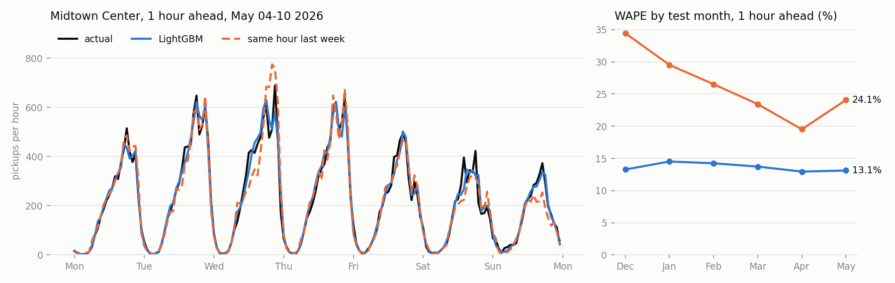
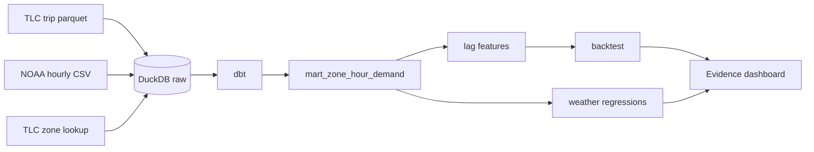

# NYC Taxi Demand Forecasting & Operations Intelligence Platform

[](https://github.com/pratri/nyc-taxi-demand-forecasting/actions/workflows/ci.yml)

[Dashboard](https://nyc-taxi-analytics.vercel.app/)



Forecasts hourly yellow cab pickups for each NYC taxi zone, 1 and 6 hours ahead. Built on 109M TLC trips from Jan 2024 to May 2026 and hourly weather from the Central Park NOAA station.

This started as a dbt project on driver earnings and weather. With daily weather I couldn't find much of an effect, but hourly weather showed a clear one, so I wanted to see if it helps forecast demand. It mostly doesn't.

## Results

Rolling backtest over 6 test months (Dec 2025 to May 2026), 103 zones, about 450k zone-hours per horizon. WAPE is total absolute error divided by total pickups.

| Model | 1h ahead | 6h ahead |
|---|--:|--:|
| Same hour last week | 26.4% | 26.4% |
| Same hour, last 4 weeks averaged | 23.3% | 23.3% |
| Last hour carried forward | 25.8% | 83.7% |
| LightGBM | **13.6%** | **16.3%** |
| MLP with zone embeddings | 14.4% | 17.4% |
| GRU over last 24h | 14.3% | 17.6% |

LightGBM cuts the baseline error by 30 to 50%. The neural nets are close but worse at both horizons, and the gap holds up when resampling by day (`artifacts/model_comparisons.csv`). They were also much slower to train on CPU.

It does worst on holidays (17.8% vs 13.5% on normal days), rainy hours (17.9% when it's raining at least 1mm), and in Brooklyn and the Bronx (35% and 46%), where zones are small and a few pickups is a big percentage.

The models predict a Poisson mean, so they come with an 80% interval, but it's too narrow for busy zones: actuals land inside it 63% of the time 1 hour ahead and 57% at 6 hours. Busy zones are more variable than Poisson assumes.

### Weather

Rain lines up with clear changes in pickups. Poisson regression with hour-of-week and month effects, standard errors clustered by day:

| | Light rain (≤1mm/h) | Heavy rain (>4mm/h) | Snow |
|---|--:|--:|--:|
| Manhattan core | +6.5% [4.9, 8.2] | +16.3% [8.8, 24.3] | -15.4% [-26.3, -2.9] |
| Outer boroughs | +5.5% [3.1, 8.0] | +17.7% [6.4, 30.1] | -17.3% [-31.0, -0.8] |
| Airports | -1.0% [-2.9, 0.9] | -10.5% [-17.0, -3.5] | -28.4% [-37.3, -18.3] |

On daily totals only 2 of the 9 rain terms are significant. Rain comes in short bursts and a daily total mostly hides it, which is why the first version found so little.

Weather features still didn't help the forecasts:

| LightGBM variant | 1h | 6h |
|---|--:|--:|
| No weather | 13.6% | 16.3% |
| Rain and snow | 13.6% | 16.4% |
| Rain, snow, temperature, wind | 13.8% | 17.4% |
| Actual weather at the target hour | 13.8% | 16.9% |

An hour ahead, the last hour's pickups already show the rain. Temperature made things worse, even with the real future weather. My guess is it acts as a proxy for the season and two winters isn't enough data for that. The final model uses no weather.

## How it works



- `taxi/ingest.py` downloads the data and parses the NOAA reports
- `dbt/` cleans trips and builds `mart_zone_hour_demand`, every modeled zone for every hour
- `taxi/features.py` builds lag features for a horizon
- `taxi/models/` has the baselines, LightGBM, MLP and GRU
- `taxi/backtest.py` trains and scores each test month
- `taxi/weather_effect.py` runs the regressions, `taxi/export.py` writes the dashboard tables

## Notes

**Backtest.** Each test month early-stops on the 4 weeks before it, then refits on everything before the month. No random splits, since those would let the model train on hours after the one it's predicting.

**No leakage.** A 6-hour forecast for 3pm can only use data up to 9am. `tests/test_features.py` scrambles everything after the forecast time and checks the features don't change. I shifted a feature by an hour on purpose to make sure it fails.

**Poisson loss.** Pickups are counts, so LightGBM uses the Poisson objective and the neural nets use Poisson NLL, with the 4-week hour-of-week average as an offset.

**Zones.** A zone is included if it averaged at least 1 pickup an hour in 2024. That's 103 zones and 99% of pickups.

**Daylight saving.** TLC times are local, so the spring-forward 2am has no trips and the fall-back 1am has two hours of them. Both are flagged in dbt and left out.

**Weather data.** NOAA's old LCD API stops in Aug 2025, so this uses the v2 yearly files. Only the routine hourly reports are used. There's a 3-day gap starting Aug 30, 2025, where temperature and wind are filled from nearby days and rain is set to 0.

**Tuning.** I changed the LightGBM learning rate and dropped weather after seeing test results, so I rechecked both on Oct and Nov 2025 with the rule decided beforehand (`taxi/tune.py`). I kept the same setup. A learning rate of 0.05 was 0.07 points better, which is inside the margin I set.

## Tests

- dbt: panel pickups and dropoffs reconcile with the raw trips, the panel is exactly zones x hours, only real DST hours get flagged
- pytest: leakage check, GRU history window, NOAA parsing, metrics
- CI runs the whole pipeline on a 3% sample (`sample_data/`) and fails if LightGBM doesn't beat the baselines

## Limitations

- These are completed pickups, not demand. If every cab is full in the rain, the data can't show it. No Uber or Lyft.
- One seed per model and no real hyperparameter search.
- TLC data comes out a couple of months late, so this can't run live.
- One weather station for the whole city.
- The "where to go next" table on the dashboard is rough. There are no driver IDs, so wait times aren't known.
- Only credit card tips are recorded.

## Running it

Python 3.9+, about 15GB of disk for the full data.

```bash
python -m venv .venv
source .venv/bin/activate    # .venv\Scripts\activate on Windows
pip install torch==2.8.0 --index-url https://download.pytorch.org/whl/cpu
pip install -r requirements.txt

python -m taxi sample        # whole pipeline on the sample
python -m pytest tests
```

Full run:

```bash
python -m taxi download
python -m taxi load
python -m taxi build         # dbt build + tests
python -m taxi backtest      # takes hours, mostly the GRU
python -m taxi report
python -m taxi tune          # optional, ~1h
python -m taxi weather
python -m taxi export
cd reports && npm install && npm run sources && npm run dev
```

`--folds 2025-12 2026-01` splits the backtest across processes and `--models` reruns specific models. `report` uses the latest run of each.

## Data

- [NYC TLC Trip Record Data](https://www.nyc.gov/site/tlc/about/tlc-trip-record-data.page)
- [NOAA Local Climatological Data](https://www.ncei.noaa.gov/products/land-based-station/local-climatological-data), Central Park
